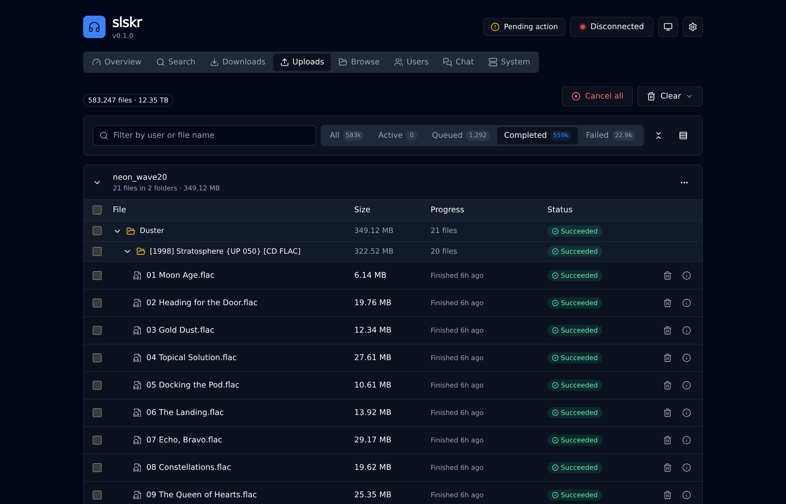
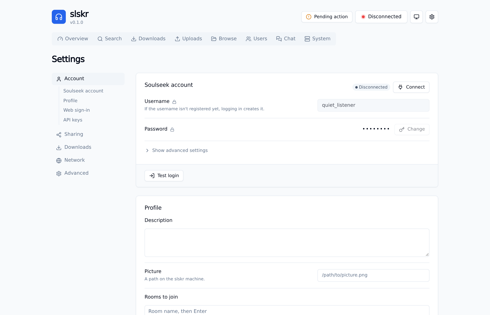

# slskr

slskr is a self-hosted [Soulseek](https://www.slsknet.org) client: a daemon that stays
connected to the Soulseek network, shares your files, and lets you search, download and
chat from a web UI. It is a single binary with the UI built in, written in Rust.

**This is intended to be deployed on a server.**


<table>
  <tr>
    <td></td>
    <td></td>
  </tr>
</table>

These screenshots are anonymized.

## Performance

Numbers from one real instance (i7-8700K, NixOS) sharing 29,978 files (0.57 TiB), taken from
the profile report slskr writes to its log every 15 minutes. Over 16.5 hours on
2026-11-26 it finished 4,280 uploads (100.6 GiB):

| | |
|---|---|
| CPU | 3.4% of one core (median), 6.6% at peak |
| Memory (RSS) | 72–138 MiB |
| All-time Overview reports over 1.2 M transfer rows | about 70–300 ms each |
| Binary with the UI embedded | 30 MB |
| Web UI (WASM) | 3.5 MB, 1.4 MB gzipped |

## Quick start

### Docker Compose

```sh
docker compose up -d
docker compose logs slskr   # shows the setup code
```

Open <http://localhost:5031/setup> and complete [first-run setup](#first-run) with the
setup code from the log. Settings, databases and downloads live in the `slskr-data` volume
(`/data`). To share music, uncomment the bind mount in
[`docker-compose.yml`](docker-compose.yml) and add `/music` to the shares. Forward port
50300 on your router so other users can connect to you.

### Nix

```sh
nix run . -- --data-dir ~/.local/share/slskr
```

`nix build .#slskr` puts the same single binary in `result/bin/slskr`. On the first start
it prints the setup URL at `127.0.0.1:5031`. See [First run](#first-run).

## First run

A fresh install has no web password. The daemon prints a one-time setup code and the setup URL
(`http://<web.listen><web.url_base>/setup`) to its log and stderr. Open the URL, choose the web username and password, and
optionally enter your Soulseek account and the directories to share. From the daemon's own machine no code is needed. If you don't have a Soulseek account yet, create one with the official client from [slsknet.org](https://www.slsknet.org) first.

Setting `web.password` in `slskr.toml` or `SLSKR_WEB_PASSWORD` skips setup; so does
`web.auth = false`. See [docs/API.md](docs/API.md#first-run-setup) for the details.

## Configuration

Most settings are changed in the web UI (Settings: the gear button at the top right).
Things you want to keep in a file or set before the first start (web credentials, the
listen address, the URL base behind a reverse proxy) go in `slskr.toml` in the data directory
or in `SLSKR_<SECTION>_<KEY>` environment variables; anything set there is locked in the UI.
Start from [`slskr.example.toml`](slskr.example.toml); [docs/CONFIGURATION.md](docs/CONFIGURATION.md)
lists every key.

```toml
[web]
username = "admin"
password = "a password for the web UI"
```

## API

Everything the UI does goes through a JSON API under `/api`, with live updates on one
WebSocket. Create an API key in the UI to script it; [docs/API.md](docs/API.md) lists
every route.

## License

slskr was based on [slskd](https://github.com/slskd/slskd) and
[Soulseek.NET](https://github.com/jpdillingham/Soulseek.NET) and has since been completely rewritten. It is
not affiliated with either project and is not compatible with their APIs. AGPL-3.0-or-later; see [LICENSE](LICENSE).
